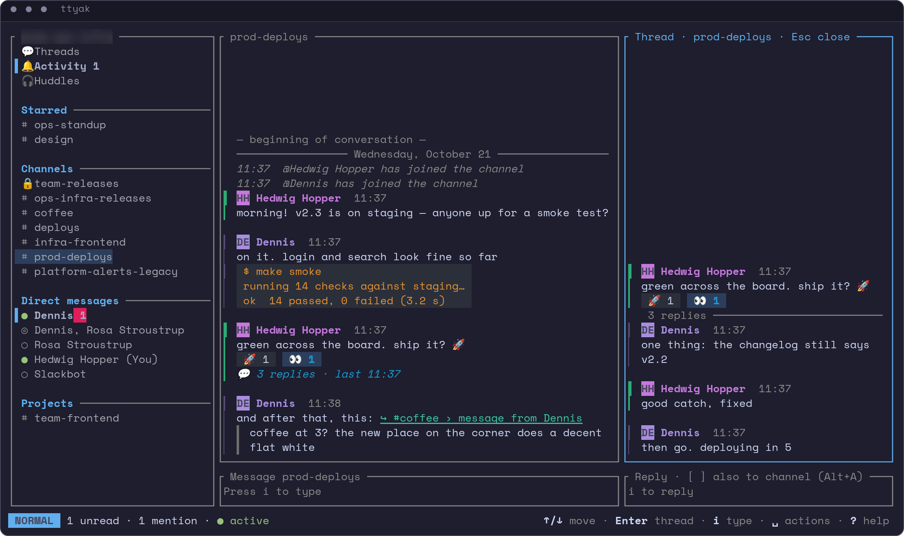
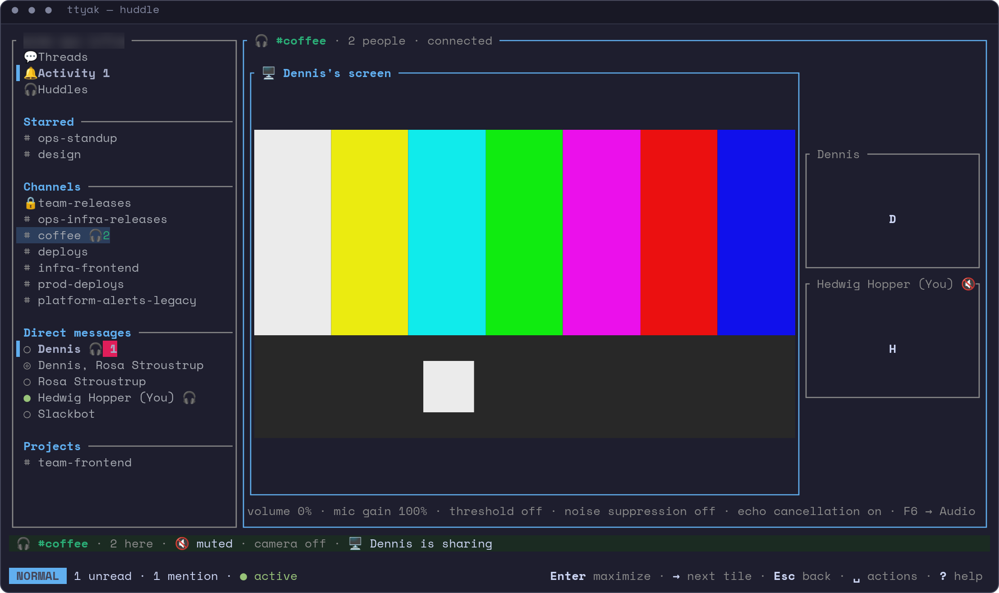
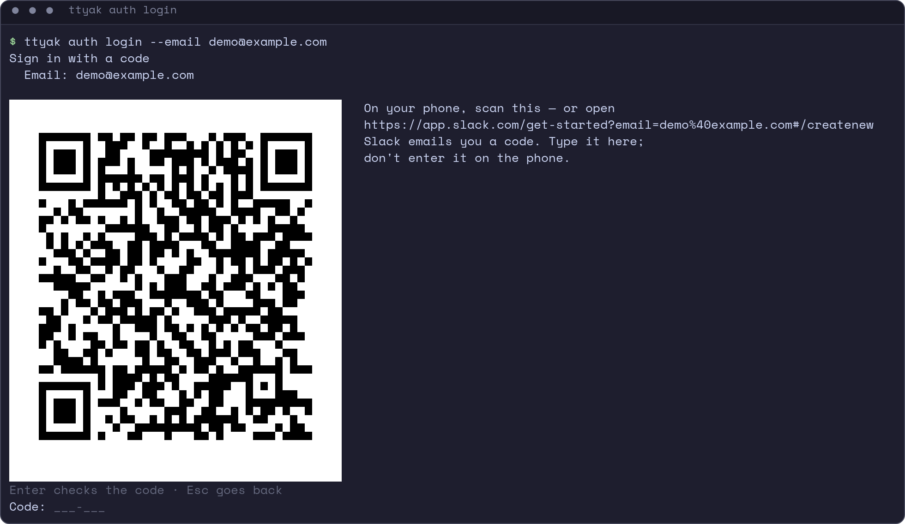

# ttyak

[](https://github.com/dmytrobsp/ttyak/releases/latest)
[](https://github.com/dmytrobsp/ttyak/actions/workflows/ci.yml)
[](#licence)
[](https://github.com/dmytrobsp/homebrew-ttyak)
[](https://github.com/dmytrobsp/scoop-ttyak)
[](https://community.chocolatey.org/packages/ttyak)

A Slack client for the terminal, written in Rust.

**[ttyak.sh](https://ttyak.sh/)** — the site and the downloads · **[The wiki](https://github.com/dmytrobsp/ttyak/wiki)**
— the manual



<p>
</p>

## What ttyak is

ttyak does in a terminal what Slack's desktop app does in a window: messages and threads, reactions, search, pictures
and video, desktop notifications, and huddles (calls) with audio, cameras and screen sharing. How it differs from the
official app:

- it runs in a terminal, also over SSH;
- it is far lighter: download, disk, memory and CPU against the official app are measured on
  [ttyak.sh](https://ttyak.sh/#numbers);
- it is **not an official Slack app** and is not affiliated with Slack. It talks to Slack the way the web client in
  your browser does.

ttyak was called klack until 0.9 (and slacktui before that); folders of the old names are not read. <!-- old-name-ok -->

What it shows and how to use it: [The screen](https://github.com/dmytrobsp/ttyak/wiki/The-screen),
[Keys](https://github.com/dmytrobsp/ttyak/wiki/Keys), [Huddles](https://github.com/dmytrobsp/ttyak/wiki/Huddles) and
the rest of the [wiki](https://github.com/dmytrobsp/ttyak/wiki).

## Signing in

**Read this first: signing in is not as smooth as in Slack's own app.** ttyak is not an official app and not a desktop
app with windows of its own, so it can't take the "open in Slack" (`slack://`) link that Slack's sign-in ends with, and
it doesn't use Slack's sign-in for apps. It uses a browser session instead (an `xoxc-…` token plus the `d` cookie),
which it gets in one of three ways:

- **a code from your email:** you ask Slack for a code on your phone or in any browser and type it into ttyak (works
  over SSH and without a browser);
- **your browser:** you sign in to Slack in a browser on the same machine, and ttyak picks the session up from the
  browser's files;
- **a pasted cookie:** you copy the `d` cookie from a browser's developer tools.

Workspaces that require SSO or two-factor sign-in can't use the email code (ttyak shows them dim); sign in to those in
your browser (not tried yet with such a workspace). `ttyak auth login`, or plain `ttyak` the first time, guides you.
All of it, step by step: [Signing in](https://github.com/dmytrobsp/ttyak/wiki/Signing-in).

## Install

Linux and macOS:

```sh
curl -fsSL https://ttyak.sh/install.sh | sh
```

Windows (PowerShell):

```powershell
irm https://ttyak.sh/install.ps1 | iex
```

The script puts the latest release in `~/.local/bin` (Windows: `%LOCALAPPDATA%\Programs\ttyak`) and on your PATH,
after checking it against the release's `SHA256SUMS`. `ttyak.exe` is not code-signed yet: if SmartScreen warns, **More
info → Run anyway**. Or with a package manager:

| Package manager | |
|---|---|
| Homebrew (macOS, Linux) | `brew install dmytrobsp/ttyak/ttyak` |
| Scoop | `scoop bucket add ttyak https://github.com/dmytrobsp/scoop-ttyak`, then `scoop install ttyak` |
| Chocolatey | `choco install ttyak` |
| winget | `winget install dmytrobsp.ttyak` — not listed yet (its first version is waiting for review) |
| Debian, Ubuntu · Fedora, RHEL | the release's `.deb` · `.rpm` |
| Arch | not in the AUR yet: `makepkg -si` with the release's recipes zip |

Or unzip a release's zip by hand. Every way, in full:
[Install](https://github.com/dmytrobsp/ttyak/wiki/Install).

### Requirements

- a UTF-8 terminal of at least 80 × 24 cells: ttyak draws its screen in it;
- an emoji font and a symbol font (macOS and Windows have them): without them emoji and symbols show as boxes;
- on Linux, ALSA's library (`libasound.so.2`, on every desktop Linux): ttyak plays sound and huddle audio through it
  and doesn't start without it;
- `ffmpeg` / `ffprobe` (optional): video, cameras and screen sharing;
- a terminal with graphics, such as kitty, WezTerm or foot (optional): real pictures instead of half blocks;
- a notification server on Linux (optional): desktop notifications.

`ttyak ctl check` tells you what your terminal and system offer. The fonts to install, per system, and the rest:
[Requirements](https://github.com/dmytrobsp/ttyak/wiki/Requirements).

### Verify

Each release file has its line in the release's `SHA256SUMS` and a GitHub attestation:
[Verifying downloads](https://github.com/dmytrobsp/ttyak/wiki/Verifying-downloads).

### Update

ttyak tells you when a new version is out, and F6 → Updates shows what to run for the way you installed it (for the
install script, an **Update now** in ttyak itself):
[Update](https://github.com/dmytrobsp/ttyak/wiki/Install#update).

### Uninstall

`ttyak uninstall` for the install script, your package manager's remove otherwise; `ttyak purge` deletes your ttyak
data: [Uninstall](https://github.com/dmytrobsp/ttyak/wiki/Install#uninstall).

## Build and contribute

With a recent stable Rust toolchain, a C/C++ compiler, `pkg-config`, cmake and (on Linux) the ALSA headers:

```sh
cargo build --release
./target/release/ttyak
```

The packages per system: [Building from source](https://github.com/dmytrobsp/ttyak/wiki/Building-from-source). How to
work on ttyak (tests, logs, a test workspace): [CONTRIBUTING.md](CONTRIBUTING.md). Bugs and ideas go to the
[issues](https://github.com/dmytrobsp/ttyak/issues).

## Project layout

- `crates/slack-core` — sessions and signing in, the Web API client, real-time events, message formatting
- `crates/huddle` — huddles: signaling, WebRTC audio and video, audio devices, cameras and screen capture
- `crates/ttyak` — the program: the terminal UI and the `ctl`, `auth` and other commands
- `vendor/rtc-turn`, `vendor/crossterm` — two patched dependencies (each folder's `TTYAK-PATCH.md` says why)

The whole map: [Project layout](https://github.com/dmytrobsp/ttyak/wiki/Project-layout).

## Licence

ttyak is licensed under either of the [Apache License, Version 2.0](LICENSE-APACHE) or the
[MIT licence](LICENSE-MIT), at your option. Unless you say otherwise, any contribution you submit
for inclusion in ttyak is licensed the same way, without any additional terms or conditions.
`vendor/rtc-turn` is webrtc-rs' code (MIT or Apache-2.0, its licence files are in that folder) and `vendor/crossterm`
crossterm's (MIT).
